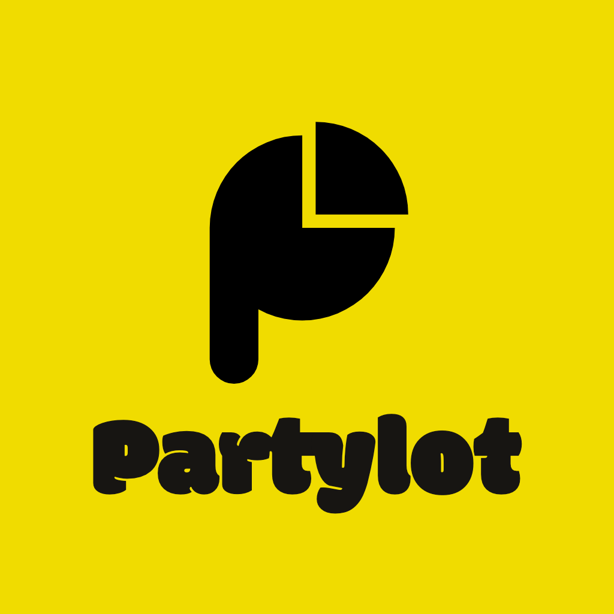

# Partylot — your crew's night, owned by your crew

**Partylot is a private social app where real-world friend groups play, split, pool money and keep their history together.** Games and plans live offchain; the shared pot, rewards, settlements and the "who-showed-up-with-whom" graph live on **Monad**.

| | |
|---|---|
| **Live product** | <https://partylot.vercel.app> (Monad Testnet, chain ID 10143) |
| **Onchain stats** | <https://partylot.vercel.app/stats> |
| **Track** | Metropolis — **Track 03: Social, Attention & Culture** |
| **Demo video (≤3 min)** | _add link before submitting_ |
| **Pitch video (≤2 min)** | _add link before submitting_ |
| **Product ad (30 s)** | [](https://youtu.be/EmNsRLpgXoI) |
| **Logo** |  |
| **License** | [MIT](LICENSE) |

## The problem and who it's for

Nights out are organised in group chats: *what's the plan, who's coming, where, who's paying?* Everything that happens afterwards — who paid for the pizza, who's always there, who won the game — disappears into the chat scroll or into a platform that owns the group. Social apps measure who you *follow*, not what you *do together*.

**Intended users:** groups of 4–20 friends (students, roommates, recurring crews, 18–30) who already meet in person and coordinate in WhatsApp/iMessage. They don't think of themselves as crypto users.

**What changes with Partylot:** participation becomes stake. Showing up, playing, chipping into the pot and doing tasks for the group are recorded where the group — not a platform — controls them: the pot belongs to the members, rewards are paid from it, and the group's shared history is a portable graph.

## What a judge can try (5 minutes)

1. Open <https://partylot.vercel.app> on a phone (or a narrow desktop window).
2. **Log in** with email (one-time code), Google or Apple through Privy. An embedded wallet on Monad Testnet is created automatically. Judge test login: _see the submission form_ (Privy test account; credentials are not stored in this repo).
3. **Create a party** (`+`) or join one with the 4-character code; share the invite link to a second device.
4. **Play**: open *Play* → *Who's Most Likely?* or *This or That*. Each person has one vote per question (changing your vote moves it); tap **Ver resultado / View result** to reveal the winner.
5. **Split** an expense between members and settle it.
6. **Party Pot**: deposit testnet MON (get some at the [Monad faucet](https://faucet.monad.xyz)). The deposit is a real transaction to `PartyTreasury`; the confirmation shows the transaction hash. The host can reward a member from the pot.
7. **Recap** and **/stats** show the night's activity and the indexed onchain events.

## How Partylot uses Monad

| Onchain (Monad Testnet) | Why onchain | Offchain (Supabase) |
|---|---|---|
| Party pot deposits (`PartyTreasury.deposit`) | Funds belong to the group, verifiable balance per member | Profiles, photos, chat-like activity |
| Rewards from the pot (`distributeReward`) | Turns contribution (DJ, bring ice, game winner) into economic stake | Games and votes (high-frequency, private) |
| Reimbursements and debt settlement | Final, auditable settlement between friends | Expense math and balances |
| Pro-rata refunds, rollover to the next party, close & sweep | Group-owned treasury lifecycle | Invite codes (mapped to secure invitations) |
| `SocialGraph.recordGathering` | Portable "nights together" graph that doesn't depend on our database | Sensitive party details |

**Why Monad:** a party is a burst of tiny, frequent money actions from people standing in the same room. With ~800 ms finality and high throughput, a deposit or a reward confirms before the conversation moves on, and fees are low enough for $2–$20 amounts. The app shows an optimistic state and only commits the database after `receipt.status === 'success'` (fail-closed).

### Deployed contracts (Monad Testnet, chain ID 10143)

| Contract | Address | Purpose |
|---|---|---|
| PartyTreasury V2 | [`0x7e92f443c26c36e80a7f7ab8939a915dd9fbd991`](https://testnet.monadexplorer.com/address/0x7e92f443c26c36e80a7f7ab8939a915dd9fbd991) | Party pots: deposits, rewards, reimbursements, settlements, refunds, rollover |
| PartyRegistry | [`0xce58a0cf7b9f80994eaeba0138e1525496090d25`](https://testnet.monadexplorer.com/address/0xce58a0cf7b9f80994eaeba0138e1525496090d25) | Parties and membership events |
| SocialGraph | [`0x11ca2ef9acad94fe83d3269bdeabd2c1b627b3d2`](https://testnet.monadexplorer.com/address/0x11ca2ef9acad94fe83d3269bdeabd2c1b627b3d2) | Shared-experience graph (gatherings, ties) |

Owner / relayer: [`0x3e040C0e394e2409C29906f275C041dFEd005fAb`](https://testnet.monadexplorer.com/address/0x3e040C0e394e2409C29906f275C041dFEd005fAb). Deployed 2026-10-12 from the sources in [`contracts/`](contracts) (solc 0.8.24, optimizer 200 runs, `pnpm contracts:build`).

Transactions:

| What | Hash | Block |
|---|---|---|
| Deploy SocialGraph | [`0xdfe20131…3bbfdc`](https://testnet.monadexplorer.com/tx/0xdfe201314440cda8c49b2fc7de71b84893960f431384eb459ad5e50e3c3bbfdc) | 70,555,033 |
| Deploy PartyRegistry | [`0x61daafd7…bcd53c2`](https://testnet.monadexplorer.com/tx/0x61daafd7ea03b760962a83954bc6b807bb0ffe8693d95b686fe0c6f99bcd53c2) | 70,555,035 |
| Deploy PartyTreasury V2 | [`0xec8dd18c…f7007b50`](https://testnet.monadexplorer.com/tx/0xec8dd18cd43f5c23f98fd8678d6f53d4f36d80a4152d9e5306572cecf7007b50) | 70,555,037 |
| Smoke test: register party | [`0x79ec0925…3d45a39`](https://testnet.monadexplorer.com/tx/0x79ec092556193430343093627df14272b1d50a57cdd4e6b0c17b565a13d45a39) | 70,555,510 |
| Smoke test: deposit 0.01 MON | [`0x904c05f8…9f22e`](https://testnet.monadexplorer.com/tx/0x904c05f89ebec706d1ca4429c00635a6c06a8bf1a4a790b3e6121a2528c9f22e) | 70,555,512 |
| Smoke test: close pot & withdraw | [`0x7539a110…6d0e58b`](https://testnet.monadexplorer.com/tx/0x7539a110e04c5ed9eed6a50e12c5e87fa8e6688e76dddbaee6b5e9e9c6d0e58b) | 70,555,515 |
| Deposit from the live product | _add hash before submitting_ | |

The three smoke-test transactions (register → deposit → withdraw) confirmed end to end in **2.4 s**.

Sources in [`contracts/`](contracts), compiled ABI/bytecode in [`contracts/artifacts/`](contracts/artifacts), client config in [`src/contracts/index.ts`](src/contracts/index.ts), indexer in [`indexer/`](indexer) (Envio HyperIndex).

> **Retired deployments.** The previous contracts (`0x69c7…97c3` treasury, `0xb7d9…ebad` registry, `0x7e87…adf9` social graph) were owned by a deployer key that leaked into git history. They are no longer used by the app and must not receive funds. Details: [`docs/SECURITY_INCIDENT_2026-10.md`](docs/SECURITY_INCIDENT_2026-10.md).

## Architecture

```text
Browser (Next.js 16 / React 19, mobile-first PWA)
 ├─ Zustand store ── optimistic UI, game state, i18n (ES/EN)
 ├─ Privy ────────── login (email, Google, Apple, SMS, wallet) + embedded wallet
 ├─ Viem ─────────── user-signed calls to PartyTreasury / PartyRegistry on Monad
 └─ /api/* (Next.js route handlers, Privy bearer auth + rate limits)
      ├─ parties, join, invites, games (server-side vote tally, one vote per user)
      ├─ treasury/action, social-graph/attest ── testnet relayer fallback (server key)
      └─ Supabase (Postgres + realtime, deny-by-default RLS, SQL migrations)
Monad Testnet ── PartyTreasury V2 · PartyRegistry · SocialGraph
Envio HyperIndex ── indexes contract events → /stats
```

**Stack:** Next.js 16.3, React 19, TypeScript, Tailwind CSS 4, Zustand, Framer Motion, Privy, Viem, Supabase, Solidity ^0.8.24, Envio HyperIndex, Vitest, Playwright.

**Security model (short):** users sign their own transactions; private keys never reach our servers. The relayer route exists only as a testnet convenience and is marked non-production (roadmap: ERC-4337 paymaster or scoped session keys). Mutating APIs require a verified Privy token and party membership; game votes are tallied on the server with the caller's verified id, so nobody can vote for someone else or rewrite counts. `pnpm release:check` blocks secrets in tracked files. See [`SECURITY.md`](SECURITY.md).

## Run it locally

Requirements: Node.js ≥ 22.13, pnpm 11.15.0.

```bash
git clone https://github.com/lawxr/PartyLot.git
cd PartyLot
pnpm install
cp .env.example .env.local     # fill in your own Privy, Supabase and Monad values
pnpm dev                       # http://localhost:3000
```

- **Privy:** `NEXT_PUBLIC_PRIVY_APP_ID` and server-only `PRIVY_APP_SECRET`.
- **Supabase:** URL, anon key and server-only service-role key; apply [`supabase/migrations`](supabase/migrations) in filename order.
- **Monad:** `NEXT_PUBLIC_MONAD_RPC_URL` (defaults to the public testnet RPC). The contract addresses above are the defaults; override with `NEXT_PUBLIC_*_ADDRESS`.
- **Optional relayer:** a funded `MONAD_DEPLOYER_PRIVATE_KEY` (server-only, never commit it).
- `NEXT_PUBLIC_PARTYLOT_DEMO_MODE=true` enables demo fixtures in development only; it is ignored in production builds.

Deploy your own contracts (uses `contracts/artifacts` and `MONAD_DEPLOYER_PRIVATE_KEY` from `.env.local`):

```bash
npx tsx scripts/deploy.ts --all
```

Checks:

```bash
pnpm release:check   # secrets scan, slop scan, typecheck, lint, 257 unit tests, production build
pnpm test:e2e        # Playwright (mobile Safari + desktop Chrome)
```

Hosting: the live product runs on Vercel from `main`; set the same environment variables in the Vercel project.

## Build window and originality

- The repository was created on **2026-09-22**, inside the hackathon period (Sep 1 – Oct 13, 2026); the full commit history is public.
- There is **no pre-existing product code**. Everything in `src/`, `contracts/`, `indexer/`, `supabase/` and `tests/` was written during the hackathon. Third-party code is used only as npm dependencies (listed below).
- Local-only tooling folders (`trailer-film/`, `launch-film/`, `.agents/`) are gitignored and not part of the submission.

## AI tools used (disclosure)

AI coding tools were used throughout, with humans directing the work and reviewing every change (typecheck, lint, tests and build must pass before a commit):

- **OpenAI Codex** — task decomposition and roadmaps.
- **Claude Code / Claude (via the pi agent harness)** — refactors, security fixes, UI/UX audits, design system work and the games UI, plus the promotional trailer.
- **Gemini CLI / Antigravity** — test authoring (Vitest, Playwright) and relayer fail-closed checks.
- **Design/video tooling** — the `frontend-design` and `impeccable` skills for UI audits; **HyperFrames** for the 30-second product ad.

## Credits and third-party licenses

| Dependency | License |
|---|---|
| Next.js, React, Viem, Zustand, Framer Motion, Supabase JS, qrcode | MIT |
| Privy (`@privy-io/react-auth`, `@privy-io/server-auth`), jsQR | Apache-2.0 |
| Lucide icons, canvas-confetti | ISC |
| Fonts: Fredoka, Modak (Google Fonts) | SIL OFL 1.1 |
| Party cover photos in demo/mock data | Unsplash License |

Monad, Metropolis and their logos are trademarks of the Monad Foundation and are referenced only to describe the integration and the hackathon.

## Team

Built by **Law** ([@lawxr](https://github.com/lawxr)) and **Gabriela** ([@gabriela611](https://github.com/gabriela611)).

## License

[MIT](LICENSE) © 2026 Law & Gabriela.
